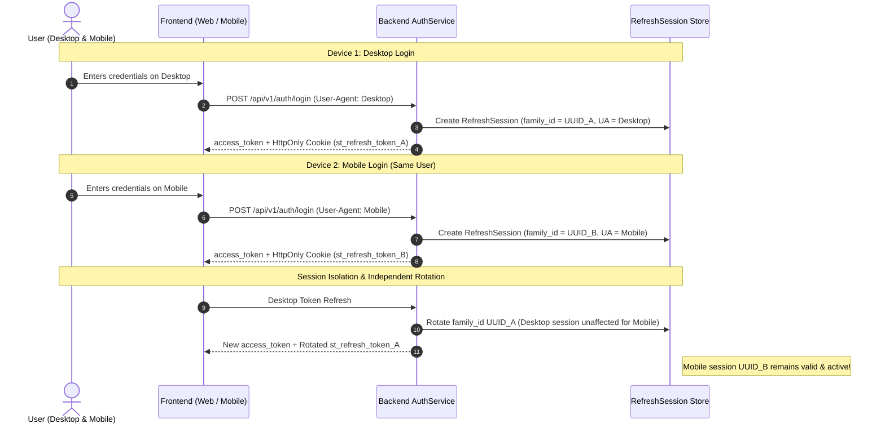

# SentinelTrace High-Availability & Traffic Management System Design

## 1. Executive Summary & Design Goals
SentinelTrace is designed to handle high-concurrency multi-tenant threat intelligence and digital forensic investigations without server crashes, latency degradation, or connection starvation.

### Key Objectives:
- **Zero Server Crashes Under Spikes:** Buffer, throttle, and load-balance incoming multi-user traffic through an intelligent reverse proxy layer.
- **Horizontal Scalability:** Support multi-replica backend workers across CPU cores and container instances.
- **Resilient Multi-Device Session Isolation:** Enable simultaneous logins across different devices (desktop, tablet, mobile) while isolating refresh token chains and guarding against token theft.
- **Graceful Degradation:** Automatic circuit breakers and async background offloading for compute-heavy ML and OSINT threat queries.

---

## 2. Multi-Tier Architecture Diagram

```mermaid
graph TD
    Client[Multi-User Clients: Web, Mobile, API Agents] -->|HTTPS / WSS| LB[Nginx Load Balancer / Reverse Proxy]
    
    subgraph "Traffic Ingestion & Protection Layer"
        LB -->|Rate Limiter: 50 req/s general, 5 req/s auth| RL[Nginx Rate & Conn Limits]
        LB -->|Buffering: 50MB EML upload buffer| BUF[Request Buffer & Slowloris Guard]
    end

    subgraph "Application Cluster (ASGI Multi-Workers)"
        LB -->|Least Connections Load Balancing| API1[Backend Replica 1: Gunicorn + Uvicorn Workers]
        LB -->|Failover & Health Probing| API2[Backend Replica 2: Gunicorn + Uvicorn Workers]
    end

    subgraph "State, Cache & Concurrency Control"
        API1 & API2 -->|FastAPILimiter / Blacklist / Sessions| Redis[(Redis 7: LRU Cache & Rate Limiting)]
        API1 & API2 -->|Async Connection Pool (20+40 overflow)| PG[(PostgreSQL 16: Asyncpg Pool)]
        API1 & API2 -->|Threat Graph Queries| Neo4j[(Neo4j 5 Graph DB)]
        API1 & API2 -->|Queue Heavy Forensic Jobs| Celery[Celery Async Task Workers]
    end
```

---

## 3. Traffic Management & Anti-Crash Strategies

### A. Reverse Proxy Load Balancing (Nginx)
1. **Load Balancing Algorithm:** `least_conn` routes incoming traffic to the backend instance with the fewest active connections, preventing worker saturation.
2. **Dynamic Failover (`proxy_next_upstream`):** If an ASGI worker returns HTTP 502/503/504 or times out, Nginx transparently replays the request to another healthy worker without failing the user.
3. **Connection Limiting (`limit_conn`):** Caps simultaneous TCP connections per IP to 30, neutralizing Slowloris and connection-starvation attacks.
4. **Rate Limiting Zones:**
   - **Authentication:** 5 requests/sec with burst=10 to protect Argon2id CPU intensive password verification.
   - **General API:** 50 requests/sec with burst=40 for real-time dashboard telemetry.
   - **SSE Real-time Stream:** Dedicated unbuffered reverse-proxy tunnel for `/api/v1/events`.

### B. ASGI Worker Pool & Memory Lifecycle
- Backend containers execute **Gunicorn** managing **UvicornWorker** processes (`multiprocessing.cpu_count() * 2 + 1`).
- **Worker Recycling (`max_requests = 5000`, `max_requests_jitter = 500`):** Automatically recycles workers after handling N requests to eliminate Python memory leaks resulting from massive RFC822 email parsing and regex evaluations.
- **Graceful Shutdown (`timeout = 120`, `graceful_timeout = 30`):** In-flight forensic reports and PDF generators finish cleanly before worker replacement.

### C. Database Connection Pooling Resiliency
- Connection pool parameters in `app.db.session`:
  - `pool_size = 20`: Baseline concurrent connection pool.
  - `max_overflow = 40`: Elastic burst capacity for sudden traffic spikes.
  - `pool_pre_ping = True`: Validates socket liveness before executing queries, preventing stale connections after firewall reboots.
  - `pool_recycle = 1800`: Recycles idle connections every 30 minutes.
  - `pool_timeout = 30`: Prevents infinite thread lockup when the pool is temporarily full.

---

## 4. Multi-Device Browser Session & Cookie Management



### Key Security & Concurrency Properties:
1. **Family Isolation:** Each login from a new device generates a distinct `family_id`. Rotating tokens on Device A never invalidates Device B.
2. **Theft Detection & Auto-Revocation:** If an attacker attempts to reuse an expired/consumed refresh token, SentinelTrace revokes the entire `family_id` branch, neutralizing replay attacks.
3. **Session Cookie Isolation:** `st_refresh_token` is scoped to `/api/v1/auth`, `HttpOnly=True`, `SameSite=Lax` (or `None` in cross-site production), and `Secure=True` in HTTPS.
4. **Global Device Invalidation:** Users can execute `POST /api/v1/auth/logout-all` to revoke all active sessions across all devices simultaneously in case of credential compromise.
